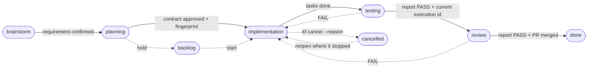
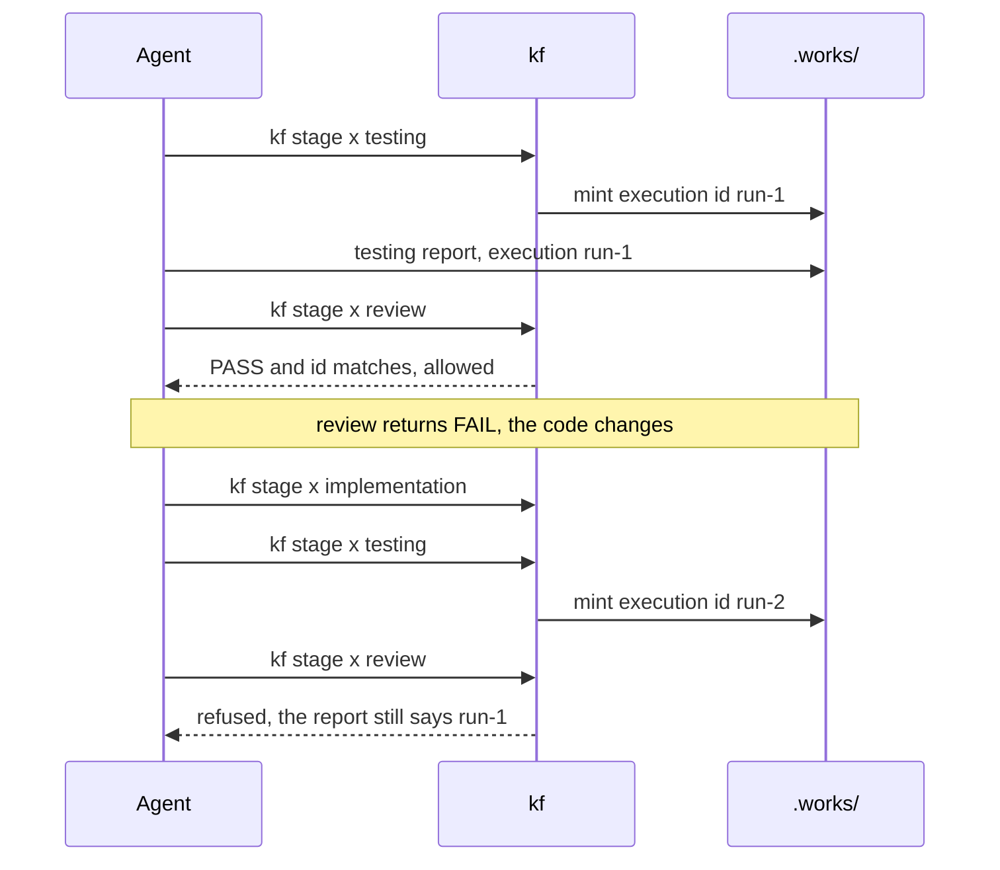

# kanban-flow

[](https://www.npmjs.com/package/@phuthuycoding/kanban-flow)
[](https://github.com/phuthuycoding/kanban-flow/actions/workflows/ci.yml)
[](LICENSE)
[](https://nodejs.org)

An AI coding agent will tell you the tests passed, the plan was followed, the
edge cases are covered. Sometimes it is right, and you cannot tell which time
from the transcript, because the transcript is written by the same thing you are
checking. kanban-flow moves the proof into files on disk: the gates do not read
the agent's summary, they read `.works/`.

## How it works

Every work item walks one pipeline, and only the CLI moves it between stages:

```text
brainstorm → planning → implementation → testing → review → done
                 ↘ backlog ↗     ↺ FAIL loops back
any stage → cancelled, with a reason on the record
```

There is no shipping stage. A review PASS opens the pull request, watches CI and
stops; you merge it on GitHub. The next `kf status` (or `kf sync`, or `kf archive`)
sees the merged PR and closes the item: the branch and the item worktree are removed
safely and the folder moves to `.works/done/`; the close copies nothing under `docs/`.
The current docs are the living docs in `docs/specs/<context>/<capability>.md`, edited
at review in one commit before the reviewers; the older `docs/requirement`,
`docs/use-cases` and `docs/testplan` snapshots wait for `/kf:docs` to consolidate
them, and `kf validate --all --base <ref>` checks the living docs in CI. Items
that deliver no code (`landing: none`) close the same way once nothing is ahead of
the default branch. `kf ship` is deprecated and exits 1 with that explanation. `kf
status --all` ends with **Needs you**, **Waiting to merge** (PR URL and the
`gh pr merge` command).

Two layers run a day. The human lives on the **day**: the `travel` skill plans the
morning from yesterday's ledger and `kf status --all`, keeps a few item slots busy
in its own session, and sorts what comes back into decisions (approve a spec) and
actions (merge this PR). Each ticket still walks the **item** ladder above, one
worktree per started item. Travel never approves, merges or archives.

Every lifecycle command has a git-flow-style spelling too — `kf feature <verb>` / `kf bug <verb>` (`start | list | show | move | approve | ship | finish | drop`); the flat commands remain permanent aliases.

Upgrading: the first `kf status` or `kf sync` moves any `.works/dones/*` item to
`done` and any `.works/shipping/*` item back to `review` (a shipping item whose PR
already merged is closed). Then run `kf doctor --fix`: it rewrites the legacy
`statusMap` key in `.kf/config.json` (`dones` → `done`,
`shipping` dropped), removes the retired `harness` keys and run state left by `kf drive`, renames `.kf/hooks/dones.sh` to `done.sh` when `done.sh` is
missing (content kept), and adds a missing `.kf/travel/` `.gitignore` entry. `KFW_PROJECT_STATUS_DONES` is
still exported to done hooks, so a legacy board move keeps working. Until then
`dones.sh` runs as the done hook; `kf doctor` flags leftovers.



Solid arrows are the happy path, and every label on one is a gate the CLI checks
before the folder moves. Dotted arrows are the ways out: hold it in backlog,
loop back on a FAIL, or stop it for good with a reason on the record.

Most stages owe an artifact. A transition is refused when that artifact is
missing, empty, still full of template placeholders, or carrying a real secret.
A testing report that does not say `PASS` does not reach review; a review report
that does not say `PASS` does not archive. `--force` overrides a gate and is
recorded in `.kfw.json` where a reviewer will find it.

Three decisions belong to a human: marking the requirement `status: confirmed`,
approving the execution contract (the approval also starts the item; `kf approve
--backlog` defers it), and merging the pull request after a review PASS. The approval is bound to a SHA-256 fingerprint of the contract, so
editing the plan invalidates it, and no stage further forward accepts the item
until it returns to planning and is approved again.

## Install

Needs Node 20 or newer.

```bash
npm install -g @phuthuycoding/kanban-flow
```

That puts `kf` on your PATH. To work from source instead:

```bash
git clone https://github.com/phuthuycoding/kanban-flow.git
cd kanban-flow && npm install && npm run build && npm link
```

## Onboard your agent

`kf init` does the filesystem half: it installs the 11 skills (`flow`,
`brainstorm`, `plan`, `implement`, `test`, `review`, `archive`, `bug`, `spike`,
`travel`, `docs`) and the 7 agents they dispatch by name — `code-reviewer`, `scout`,
`spec-reviewer`, `developer`, `test-writer`, `automation-writer`, `researcher` —
and seeds `AGENTS.md` when the project does not already have one.

**Claude Code gets them through the `kf` plugin.** `kf install` runs the two
`claude plugin` commands for you; to do it by hand, inside Claude Code:

```
/plugin marketplace add <the kanban-flow package root>
/plugin install kf@kanban-flow
```

The commands are then `/kf:flow` (the orchestrator), `/kf:brainstorm`, `/kf:plan`,
`/kf:implement`, `/kf:test`, `/kf:review`, `/kf:archive`, `/kf:bug`, `/kf:spike`,
`/kf:travel` and `/kf:docs`, and the agents are dispatched as `kf:<agent>` (`kf:developer`, ...).
The default scope is **global** (the plugin's `user` scope, so one install serves
every project and tracks package upgrades); a project that wants its own sets
`skills.scope: "project"` in `.kf/config.json` (the onboarding question asks), and
`kf install --scope` / `kf uninstall --scope` overrides it per run.

On a terminal, `kf install` and `kf uninstall` ask for what you did not pass.
`kf install` with no option first offers **Setup mode**: Quick installs exactly
what a plain `kf install` always did (`claude`, the configured scope), Customize
walks through the agents, the scope and a confirm step. `kf uninstall` asks the
agents, the scope, whether to also delete `.works/` and `.kf/` (only inside a
project), then confirms. Cancel changes nothing; Ctrl+C aborts with exit 1. In a
script or CI (no terminal) nothing is asked and the commands behave as before.

A third scope, **workspace**, is for Claude Code only: it installs the plugin at
Claude Code's `local` scope in a workspace folder, so `/kf:*` appears in every
project under that folder and nowhere else. The folder is the nearest one holding
`.kf/workspace.json` (searching up from where you run it); outside a project, the
current folder becomes the workspace and `.kf/workspace.json` is created there
once the install succeeds. If kf is also installed at user scope, the onboarding
offers to remove that install after the workspace one succeeded (No keeps it);
when nothing was asked, the output reminds you of `kf uninstall --global`.

Other runtimes (`--agent codex|gemini|kiro|cursor|opencode|devin`) have no plugin
system, so `kf install` copies the skills as `kf-<name>` directories (`kf-flow`,
`kf-plan`, ...) into the runtime's skills dir (`.agents/skills` for codex, which
follows the open standard), and the agents into its agents dir when it has one.
`kf autoconfig` and `kf doctor` report the effective scope and flag a missing,
stale or broken install; `kf doctor --fix` repairs it.

> **Breaking change.** The kanban-prefixed skills of earlier releases are replaced by
> the `kf` plugin and the `kf-<name>` copies; the old slash commands no longer exist.
> Run `kf install` to migrate: it removes the old entries it owns, leaves your own
> files alone, and installs the plugin. Use `/kf:flow` where you used the old
> orchestrator command.

The other half is `kf autoconfig`. It prints a briefing meant for the agent, not
for you: the project context, a setup checklist where every missing item carries
the command that fixes it, the effective review rules to adopt as conventions,
and the pipeline guide — generated from the CLI's own help strings. Run it and
paste the output to your agent, or tell the agent to run it and work through the
checklist itself. `kf doctor` is the complement: autoconfig asks what setup step
is missing, doctor asks what is broken. Details:
[agent onboarding](docs/workflow/autoconfig.md).

## A run, end to end

The agent runs the commands and writes the artifacts between them, taking every
template and path from `kf instruct`. `kf status` shows the artifact checklist;
`kf validate` reports what is actually blocking a gate, traceability included.

```bash
cd your-project
kf init                             # asks a few questions, seeds .kf/, installs the skills and the kf plugin
kf new user-login --context auth    # opens Phase 1 in brainstorm
kf instruct spec-requirement --change user-login
# write the requirement, set its frontmatter to status: confirmed — decision one
kf stage user-login planning
# write the plan, the use-case index, one file per UC, the diagram, the test plan
kf approve user-login               # decision two; fingerprints all of it and starts the item
                                    # (`--backlog` defers it); when the project opted in
                                    # (`worktree.enabled: true`) this also provisions a git
                                    # worktree on <git-user>/user-login with its own
                                    # <feature>.<repo>.test domain (`worktree.domains`, boolean,
                                    # default `true`; with it `false`: no `.test` DNS or proxy probes,
                                    # `kf status` prints only `http://127.0.0.1:<port>`, hooks get no
                                    # `KFW_WORKTREE_DOMAIN`; ports and routes are still allocated and
                                    # JSON outputs still carry `domain`) — see docs/workflow
kf stage user-login testing         # mints a fresh execution id
# write the testing report, carrying that id and real exit codes
kf verify user-login --stage        # runs harness.verify.stage and records the run at HEAD
kf stage user-login review          # refused unless that report says PASS and the stage record
                                    # passed at HEAD (or, with no harness.verify.stage, a waiver)
# an independent code-reviewer writes the review report (ci: green|none, landing: pr|none)
# PASS → push the branch, open the PR, watch CI
# decision three: merge the PR on GitHub
kf status --change user-login       # sees the merged PR; closes the item, removes branch + worktree
```

## What is actually different

Most of the mechanics here exist elsewhere: requirement-to-test traceability as
a CI gate, role-to-runner configuration, hash-bound plan approval, a cancelled
state with a mandatory reason, blocking placeholders. No claim to inventing them.

One mechanic I have not found anywhere else: **every entry into testing mints a
fresh execution id**, and a report is accepted only when its `execution:` field
matches the current one. Fix a failure, go round again, and yesterday's green
report is inert. Stale test evidence stops being a way to pass.



The old report is not deleted, argued with, or trusted less. It simply stops
matching, so passing again costs exactly one honest test run. The rest of the
case is the combination: a gate reading files instead of claims, an approval
bound to the bytes it approved, evidence that expires.

## In-session harness

The session you work in is the controller. It runs the phase skills, dispatches
the agents inside them and runs the mechanical checks through `kf verify`; kf
spawns no worker process and keeps no run state. In the task loop, `kf next`
prints what is due and `kf record` writes the ledger.
The commands `kf drive`, `kf run`, `kf runs` and `kf harness` were removed, together with the
role, runner and stage configuration behind them. The only `harness` keys left are the verify settings (`task`, `related`, `stage`) and the developer ceiling:

```json
"harness": {
  "verify": { "task": [["npm", "run", "typecheck"]], "related": ["npx", "vitest", "related", "--run"], "stage": [["npm", "run", "build"], ["npm", "test"]] },
  "developers": { "max": 6 }
}
```

`harness.developers.max` is the ceiling of the live developer cap (integer 1..16, default 6).
`worktree.domains` (boolean, default `true`) switches the `.test` domain off: with it `false`, there are
no `.test` DNS or proxy probes, `kf status` prints only `http://127.0.0.1:<port>`, and hooks get no
`KFW_WORKTREE_DOMAIN`; ports and routes are still allocated and JSON outputs still carry `domain`.

```bash
kf tasks user-login                                   # the task graph: waves, states, files
kf next user-login [--resume] [--json]                # the task loop's actions due now, read from the ledger; changes no file
kf record user-login dispatched TASK-001 developer --model sonnet  # appends one stamped ledger line under the item lock
kf verify user-login --task TASK-001 --base <sha>     # the task's commits stay inside its Files; runs harness.verify.task
kf verify user-login --task TASK-002 --commits <sha>[,<sha>…] [--at-head]  # exactly those commits, in a detached worktree at the newest, or at HEAD (pipelined loop)
kf verify user-login --wave 1                         # a complete wave's full suite (harness.verify.stage) in a detached worktree at HEAD; recorded like --stage
kf loop-stats user-login --record                     # where the loop's time went; writes (replacing any earlier) the item's row in .works/loop-metrics.md
kf verify user-login --stage                          # runs harness.verify.stage, records the run in loop/stage-verify.jsonl
kf verify user-login --stage --waive "no suite yet"   # no harness.verify.stage pinned: the human's reason to enter review
kf doctor --fix                                       # strips the removed harness keys and leftover run state
kf config set --global reviewer Alice                 # a personal default for every project (also --workspace)
kf config show                                        # the effective config, each value with its layer
```

`reviewer`, `agents` and `skills` can also come from `~/.kf/config.json` (global) or from the
nearest `.kf/workspace.json` in a parent folder (one workspace for several repositories).
The project's `.kf/config.json` always wins, and every other key stays project-only; see
[config layers](docs/workflow/cli-reference.md#config-layers).

`kf verify` exits 0 on a pass, 1 when a verify command failed, 2 when a file
outside the task's `Files` changed, 3 on bad input or when `kf verify` could not run (it runs nothing). kf never
runs a command taken from an artifact. If your project still has the removed
config keys or `drive`/`runs`/`sessions`/`tasks` in item metadata, `kf doctor`
warns and `kf doctor --fix` removes them.

### Independent review, and a task loop that reviews every task

The skills never let the session that wrote the code grade its own work.
`/kf:plan` dispatches a `scout` agent per thing that changes (consumers, covering
tests, dual writes, why the code exists — a `file:line` map under 40 lines) and a
`spec-reviewer` with a fresh context before the human approves. `/kf:implement`
runs the plan task by task: a `test-writer` writes the failing tests, a `developer`
makes them pass (an `automation-writer` adds the UI specs under the full level), a
`code-reviewer` reads the diff, a fix loop capped at five rounds (one minimal fix past the cap when only the smallest change is left), every decision in a ledger that survives
compaction. One fix rule holds after the loop too: a testing FAIL, a review FAIL or red CI
reopens the task that owns the failing file, and its round count continues — five rounds is
the task's whole life. `/kf:review` establishes the facts mechanically — lint, build, the
suite's real counts, the rules — writes a review pack, picks the reviewer set from the
diff size (one reviewer under 200 code lines, plus a contracts reviewer when a shared
surface changed; five dimensions in parallel above; every reviewer on `opus`, `fable`
only on a critical area), and refutes any finding whose evidence quote is missing or not where the
reviewer said it is before it reaches the report. After the review PASS, `/kf:review` pushes the branch, opens the PR and watches the
pushed commit's GitHub Actions runs and the PR's mergeability in the background. A red
run is not handed to the human at first: it writes a `ci: red` / `FAIL` report with the
failed run and its log tail and sends the item back through implementation, testing and
review, where the owning task repairs it under its five-round cap; the fix is pushed to the
same PR and watched again. Anything the watcher cannot settle (a conflict, a blocked or
timed-out PR) goes to the human. It never re-runs, cancels or approves a workflow.

### From approval to the merge gate

After the human approves the plan (which starts the item), the session runs the
rest through `/kf:implement`, `/kf:test` and `/kf:review`. The plan's task
table names a `Files` allowlist for every task, and `kf approve` seals it.

- Per task: a `test-writer`, a `developer`, then `kf verify --task` and a
  `code-reviewer` on the task's diff. The exit code of `kf verify`, not the
  developer's report, decides the task passed its mechanical checks. With
  `harness.verify.related` set (one argv, e.g. `["npx","vitest","related","--run"]`),
  `kf verify --task` appends the task's changed files to it, so a task runs only
  the tests related to what it touched.
- Per wave: once a wave's tasks are all complete, `kf next` prints
  `kf verify <feature> --wave <w>`, which runs the full `harness.verify.stage`
  suite once on the wave's head. The next wave's developers wait until that
  wave verify passed; test-writers are not held.
- Before review, `kf verify --stage` runs the commands you pinned in
  `harness.verify.stage` and records the run: the HEAD sha, whether the tracked
  tree was clean, each command's outcome and a hash of the output. `kf stage
  <f> review` moves only on a passing record at HEAD, with the commands pinned
  now, and never re-runs them. The review gate reuses the last wave's record when
  it passed at HEAD on a clean tree, so `--stage` runs only when `kf status` does
  not already show PASS at HEAD. A project with no `harness.verify.stage` enters
  review on a waiver the human gives (`--waive "<reason>"`), shown by `kf status`
  and in the review report. Testing reads the stage record instead of re-running
  the suite: it maps every test case to its test, runs the changed behaviour no
  test covers and measures line coverage per changed file. Its Commands table
  cites the record; it is not what the gate reads.
- Testing and review run through the normal gates and stop at **review PASS:
  merge the PR**, or earlier with a blocker that names the human step.
- The loop is pipelined: developers, up to the live developer cap, share one worktree on ready tasks whose
  `Files` are disjoint, each committing through `commit-task.mjs` (path-limited, lock-safe),
  while the next task's `test-writer` runs beside them; a task whose `Files` overlap an
  open one waits (`kf tasks --json` `overlaps`). An open task has a `test-writer dispatched`
  or `developer dispatched` line and no `complete` line; overlapping tasks open in wave order.
  `kf tasks <feature> --graph` shows the critical path and the max width.
- The live developer cap starts at min(2, ceiling), steps up by one after each clean parallel
  wave, and halves (never below 1) on a contention-shaped verify failure; the ceiling is
  `harness.developers.max` (integer 1..16, default 6). When the cap is full a developer waits:
  `TASK-NNN: developer waits — <N> developers in flight`. `kf tasks --json` reports
  `developers: {max, source}`, where source is `config`, `default` or `invalid-config`.
- `kf next <feature>` reads the ledger, the plan, the reports, the verify logs and `git log`
  and prints the actions due now: `dispatch`, `verify`, `write`, `complete`, `wait`, `decide`,
  `stop` or `finished`. It changes no file and starts no process; the session still spawns
  every seat with `Agent()`, and a `decide` points at the judgement the skill keeps under
  `## Decisions`. `kf record <feature> <event> …` writes each ledger line, stamped, under the
  item lock, and refuses an unknown or contradicting event.
- `kf next` computes the actions with one state machine per task, folded once from the ledger.
  One code-reviewer of a task runs at a time (`wait TASK-NNN: code-reviewer of TASK-NNN in
  flight`), and at the five-round cap a task gets the `Breaker` decide, ended by parking or
  one minimal fix past the cap, or, once reopened, the cap stop, ended by the human or that
  minimal fix. Its liveness guard gives every open task an action, an In-flight entry or a
  wait, or else `stop TASK-NNN: kf next has no rule for TASK-NNN in <phase> / … — report this with the ledger`.
- A new session runs `kf next <feature> --resume`, which lists the seats and verifies the
  ledger at `<item>/loop/progress.md` shows open; its lines end in ` @ <ISO>`, and
  `kf loop-stats` turns them into the loop's measurements.

## Releasing

Publishing to npm is manual: `gh release create v<version>` triggers
`release.yml`. kf no longer creates releases or changelog entries.

## Documentation

The full reference lives in [docs/workflow](docs/workflow/README.md): the [state
machine](docs/workflow/state-machine.md), every [gate](docs/workflow/gates.md), the
[artifacts](docs/workflow/artifacts.md), the [CLI reference](docs/workflow/cli-reference.md),
[agent onboarding](docs/workflow/autoconfig.md) including phase hooks, the
[in-session harness, `kf next`, `kf record` and `kf verify`](docs/workflow/harness.md), the [dashboard](docs/workflow/dashboard.md). Release
notes: [CHANGELOG.md](CHANGELOG.md).

## License — MIT
