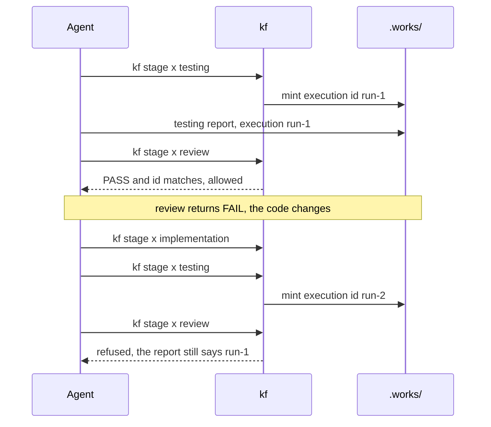
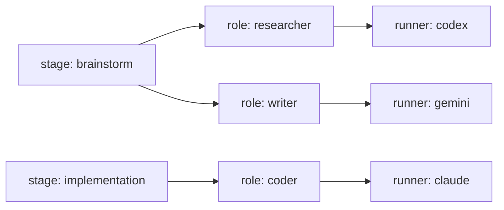

# kanban-flow

[](https://www.npmjs.com/package/@phuthuycoding/kanban-flow)
[](https://github.com/phuthuycoding/kanban-flow/actions/workflows/ci.yml)
[](LICENSE)
[](https://nodejs.org)

An AI coding agent will tell you the tests passed, the plan was followed, the
edge cases are covered. Sometimes it is right, and you cannot tell which time
from the transcript, because the transcript is written by the same thing you are
checking. kanban-flow moves the proof into files on disk: the gates do not read
the agent's summary, they read `.works/`.

## How it works

Every work item walks one pipeline, and only the CLI moves it between stages:

```text
brainstorm → planning → implementation → testing → review → done
                 ↘ backlog ↗     ↺ FAIL loops back
any stage → cancelled, with a reason on the record
```

There is no shipping stage. A review PASS opens the pull request, watches CI and
stops; you merge it on GitHub. The next `kf status` (or `kf sync`, or `kf archive`)
sees the merged PR and closes the item: the branch and the item worktree are removed
safely, the canonical docs are synced, and the folder moves to `.works/done/`. Items
that deliver no code (`landing: none`) close the same way once nothing is ahead of
the default branch. `kf ship` is deprecated and exits 1 with that explanation. `kf
status --all` ends with **Needs you**, **Waiting to merge** (PR URL and the
`gh pr merge` command) and **Running: N**.

Two layers run a day. The human lives on the **day**: the `travel` skill plans the
morning from yesterday's ledger and `kf status --all`, keeps a few worker slots busy
with `kf drive`, and sorts what comes back into decisions (approve a spec) and
actions (merge this PR). Each ticket still walks the **item** ladder above, one
worktree per started item. Travel never approves, merges or archives.

Every lifecycle command has a git-flow-style spelling too — `kf feature <verb>` / `kf bug <verb>` (`start | list | show | move | approve | finish | drop | run`); the flat commands remain permanent aliases.

Upgrading: the first `kf status` or `kf sync` moves any `.works/dones/*` item to
`done` and any `.works/shipping/*` item back to `review` (a shipping item whose PR
already merged is closed). Then run `kf doctor --fix`: it rewrites the legacy
`statusMap` and `harness.stages` keys in `.kf/config.json` (`dones` → `done`,
`shipping` dropped), renames `.kf/hooks/dones.sh` to `done.sh` when `done.sh` is
missing (content kept), and adds a missing `.kf/travel/` `.gitignore` entry. `KFW_PROJECT_STATUS_DONES` is
still exported to done hooks, so a legacy board move keeps working. Until then
`dones.sh` runs as the done hook; `kf doctor` flags leftovers.


Solid arrows are the happy path, and every label on one is a gate the CLI checks
before the folder moves. Dotted arrows are the ways out: hold it in backlog,
loop back on a FAIL, or stop it for good with a reason on the record.

Most stages owe an artifact. A transition is refused when that artifact is
missing, empty, still full of template placeholders, or carrying a real secret.
A testing report that does not say `PASS` does not reach review; a review report
that does not say `PASS` does not archive. `--force` overrides a gate and is
recorded in `.kfw.json` where a reviewer will find it.

Three decisions belong to a human: marking the requirement `status: confirmed`,
approving the execution contract (the approval also starts the item; `kf approve
--backlog` defers it), and merging the pull request after a review PASS. The approval is bound to a SHA-256 fingerprint of the contract, so
editing the plan invalidates it, and no stage further forward accepts the item
until it returns to planning and is approved again.

## Install

Needs Node 20 or newer.

```bash
npm install -g @phuthuycoding/kanban-flow
```

That puts `kf` on your PATH. To work from source instead:

```bash
git clone https://github.com/phuthuycoding/kanban-flow.git
cd kanban-flow && npm install && npm run build && npm link
```

## Onboard your agent

`kf init` does the filesystem half: it installs the nine kanban skills into the
agent's skills dir (`--agent codex|gemini|kiro|cursor|opencode|devin`; `claude` is
the default, and several agents read each other's directories), installs the three
kanban agents the skills dispatch by name — `code-reviewer`, `scout`,
`spec-reviewer` — into the runtime's agents dir when it has one (Claude Code:
`.claude/agents/`), and seeds `AGENTS.md` when the project does not already have one. By default the install is
**global** — symlinked into `~/.<agent>/skills` so one set serves every project and
tracks package upgrades (copied instead when linking is unavailable). A project
that wants its own copies sets `skills.scope: "project"` in `.kf/config.json` (the
onboarding question asks), and `kf install --scope` / `kf uninstall --scope`
overrides it per run. `kf autoconfig` and `kf doctor` report the effective scope
and flag stale or broken installs; `kf doctor --fix` repairs them.

The other half is `kf autoconfig`. It prints a briefing meant for the agent, not
for you: the project context, a setup checklist where every missing item carries
the command that fixes it, the effective review rules to adopt as conventions,
and the pipeline guide — generated from the CLI's own help strings. Run it and
paste the output to your agent, or tell the agent to run it and work through the
checklist itself. `kf doctor` is the complement: autoconfig asks what setup step
is missing, doctor asks what is broken. Details:
[agent onboarding](docs/workflow/autoconfig.md).

## A run, end to end

The agent runs the commands and writes the artifacts between them, taking every
template and path from `kf instruct`. `kf status` shows the artifact checklist;
`kf validate` reports what is actually blocking a gate, traceability included.

```bash
cd your-project
kf init                             # asks a few questions, seeds .kf/, installs the skills
kf new user-login --context auth    # opens Phase 1 in brainstorm
kf instruct spec-requirement --change user-login
# write the requirement, set its frontmatter to status: confirmed — decision one
kf stage user-login planning
# write the plan, the use-case index, one file per UC, the diagram, the test plan
kf approve user-login               # decision two; fingerprints all of it and starts the item
                                    # (`--backlog` defers it); when the project opted in
                                    # (`worktree.enabled: true`) this also provisions a git
                                    # worktree on <git-user>/user-login with its own
                                    # <feature>.<repo>.test domain — see docs/workflow
kf drive user-login                 # optional, with a task harness configured: runs the plan's
                                    # tasks in parallel worktrees, then testing and review, and
                                    # stops at the merge gate — see docs/workflow/harness.md
kf stage user-login testing         # mints a fresh execution id
# write the testing report, carrying that id and real exit codes
kf stage user-login review          # refused unless that report says PASS
# an independent code-reviewer writes the review report (ci: green|none, landing: pr|none)
# PASS → push the branch, open the PR, watch CI
# decision three: merge the PR on GitHub
kf status --change user-login       # sees the merged PR; closes the item, removes branch + worktree
```

## What is actually different

Most of the mechanics here exist elsewhere: requirement-to-test traceability as
a CI gate, role-to-runner configuration, hash-bound plan approval, a cancelled
state with a mandatory reason, blocking placeholders. No claim to inventing them.

One mechanic I have not found anywhere else: **every entry into testing mints a
fresh execution id**, and a report is accepted only when its `execution:` field
matches the current one. Fix a failure, go round again, and yesterday's green
report is inert. Stale test evidence stops being a way to pass.



The old report is not deleted, argued with, or trusted less. It simply stops
matching, so passing again costs exactly one honest test run. The rest of the
case is the combination: a gate reading files instead of claims, an approval
bound to the bytes it approved, evidence that expires.

## Multi-agent harness

Stages route to **roles**, roles point at **runners**. A runner is one way to
invoke a CLI: its argv, its permission flags, how its session resumes. A role is
a job such as researcher or tester. Pointing a role at an existing runner is one
line; a runner nobody has declared yet is a few more.

```json
"harness": {
  "main": "architect",
  "roles": { "architect": "claude", "researcher": "codex", "writer": "gemini", "coder": "claude" },
  "stages": { "brainstorm": ["researcher", "writer"], "implementation": "coder" },
  "runners": {
    "claude": { "start": ["claude", "-p", "{prompt}"] },
    "codex":  { "start": ["codex", "exec", "{prompt}"] },
    "gemini": { "start": ["gemini", "-p", "{prompt}"] }
  }
}
```



A stage runs its roles in order, and a role that declares an `output` file hands
it to the next one. A role reporting neither `DONE` nor `DONE_WITH_CONCERNS`
stops the chain. Sessions are kept per work item and per role, so two roles on
one CLI never share context.

```bash
kf harness                     # stage → role chain, role → runner, which CLIs are on PATH
kf run user-login --detach     # run the current stage's chain; poll with kf runs
kf runs user-login --json      # each run: role, runner, status, usage where reported
```

Presets ship for claude, codex, devin, gemini and opencode. Assign no stages and the harness stays out of the way.

### Independent review, and a task loop that reviews every task

Whoever runs a stage, the skills never let that session grade its own work.
`kanban-plan` dispatches a `scout` agent per thing that changes (consumers, covering
tests, dual writes, why the code exists — a `file:line` map under 40 lines) and a
`spec-reviewer` with a fresh context before the human approves. `kanban-implement`
runs the plan task by task: a fresh implementer per task, a `code-reviewer` on its
diff, a fix loop capped at five rounds, every decision in a ledger that survives
compaction. `kanban-review` establishes the facts mechanically — lint, build, the
suite's real counts, the rules — writes a review pack, picks the reviewer set from the
diff size (one reviewer under 200 code lines, plus a contracts reviewer when a shared
surface changed; five dimensions in parallel above; `opus` above 600 or on a critical
area), and refutes any finding whose evidence quote is missing or not where the
reviewer said it is before it reaches the report. After the review PASS, `kanban-review` pushes the branch, opens the PR and watches the
pushed commit's GitHub Actions runs and the PR's mergeability in the background. A red
run is not handed to the human at first: it writes a `ci: red` / `FAIL` report with the
failed run and its log tail and sends the item back through implementation, testing and
review; the fix is pushed to the same PR and watched again. A second red round goes to
the human with both rounds' failed runs, as does anything the watcher cannot settle (a
conflict, a blocked or timed-out PR). It never re-runs, cancels or approves a workflow.

### From approval to the merge gate: `kf drive`

After the human approves the plan (which starts the item), `kf drive` runs the rest
on its own. The plan's task table names a `Role` and a `Files` allowlist for every
task, and `kf approve` seals it, so the same plan always produces the same dispatch.

```json
"worktree": { "enabled": true },
"harness": {
  "verify": { "task": [["npm", "run", "typecheck"]], "stage": [["npm", "test"]] },
  "parallel": 3, "retries": 1, "maxLoops": 2, "budget": { "maxRuns": 30 }
}
```

- Each task runs in its own worktree with the role the plan declared. Up to
  `parallel` run at once, and never two whose `Files` overlap.
- kf, not the worker, decides a task is done. It checks the changed files against
  the allowlist, commits, merges into the item branch, and runs the `verify`
  commands you pinned. kf never runs a command taken from an artifact. A failing
  verify resets the merge.
- Testing and review then run through the normal gates, with bounded repair loops.
  The drive stops at **ready — review PASS: merge the PR**, or earlier with a named
  stop code and the next command to run. An API usage limit stops it with
  `usage_limit` (the reason quotes the reset time) without spending a run; `kf drive`
  resumes the kept session afterwards.
- The drive reads its harness config from the item worktree, then `origin/<default>`,
  then the primary checkout; `config_source` shows which. Workers run with streamed
  output, so `--status` and the `--watch` heartbeat show each worker's last tool call
  or text with its age, and `--tail` prints readable lines.

```bash
kf tasks user-login            # the task graph: waves, states, roles, files
kf drive user-login            # detached; starts from implementation after approval
kf drive user-login --status   # where it is, each live run, or why it stopped
kf drive user-login --watch    # stream events and a heartbeat; Ctrl+C detaches only
kf drive user-login --stop     # end it; worktrees and branches are kept
```

## Releasing

Publishing to npm is manual: `gh release create v<version>` triggers
`release.yml`. kf no longer creates releases or changelog entries.

## Documentation

The full reference lives in [docs/workflow](docs/workflow/README.md): the [state
machine](docs/workflow/state-machine.md), every [gate](docs/workflow/gates.md), the
[artifacts](docs/workflow/artifacts.md), the [CLI reference](docs/workflow/cli-reference.md),
[agent onboarding](docs/workflow/autoconfig.md) including phase hooks, the
[harness and `kf drive`](docs/workflow/harness.md), the [dashboard](docs/workflow/dashboard.md). Release
notes: [CHANGELOG.md](CHANGELOG.md).

## License — MIT
