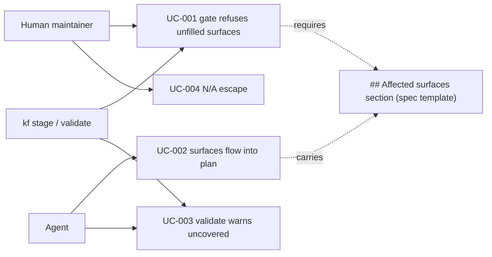

# Use Case Diagram

- Actors: human maintainer (declares surfaces, hits the gate), agent (authors spec + plan), `kf stage`/`kf validate` (enforcement machinery).
- Use cases: gate refusal on unfilled/missing section; surfaces flowing into plan tasks/doc-impact; validate warning on uncovered surfaces; the N/A escape.
- Relationships: the gate and the coverage warning both read the same spec section — one blocks at brainstorm-exit, the other warns from planning on.
