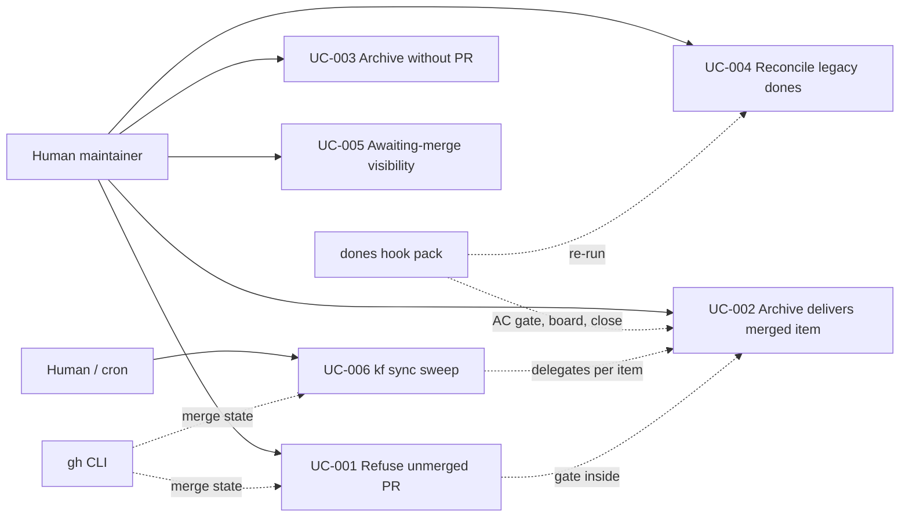

# Use Case Diagram

- Actors: Human maintainer (or cron driving `kf sync`), `gh` CLI, `dones` hook pack.
- Use cases: UC-001…UC-006 — the merge gate (UC-001) is a guard inside archive's finalization (UC-002/UC-004) and the sweep (UC-006); UC-003 is the no-evidence branch; UC-005 is read-only visibility.
- Relationships: `kf archive` is the single funnel — `kf stage x dones` and `kf sync` both delegate to it; the hook pack supplies the tracker side effects.
