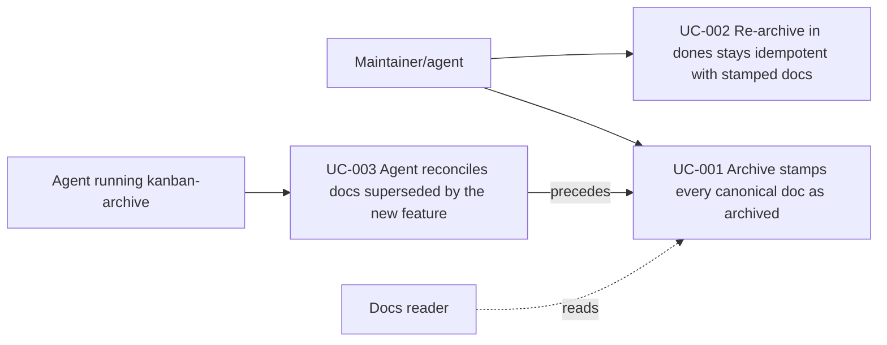

# Use Case Diagram

- Actors: Maintainer/agent, Agent running kanban-archive, Docs reader
- Use cases: UC-001, UC-002, UC-003
- Relationships: reconcile (UC-003) runs before `kf archive` (UC-001); re-archive (UC-002) reuses UC-001's stamping
