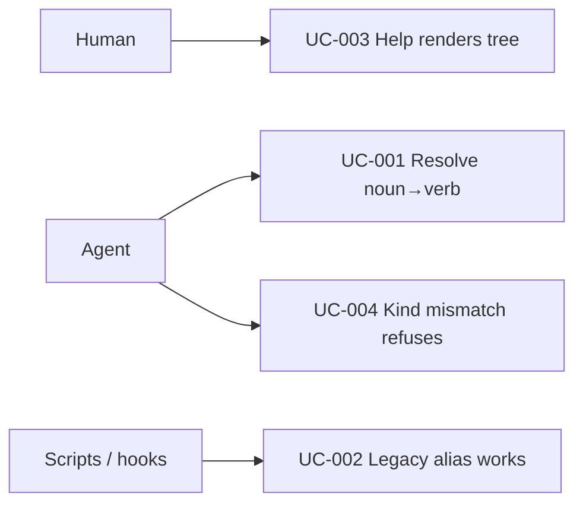

# Use Case Diagram

- Actors: Agent, Human, Scripts/hooks
- Use cases: UC-001 resolution; UC-002 compatibility; UC-003 help; UC-004 kind guard
- Relationships: UC-002 and UC-001 reach the same handlers through different spellings
