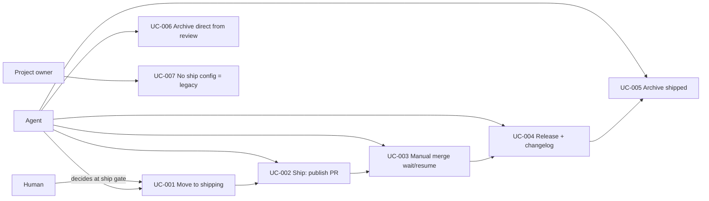

# Use Case Diagram

- Actors: Agent (runs commands), Human (ship gate + manual merge), Project owner (config)
- Use cases: UC-001 gated entry; UC-002–004 the resumable ship pipeline; UC-005–006 the two exits to dones; UC-007 backward compatibility
- Relationships: UC-002→003→004→005 form the ship chain; UC-006 is the bypass path
