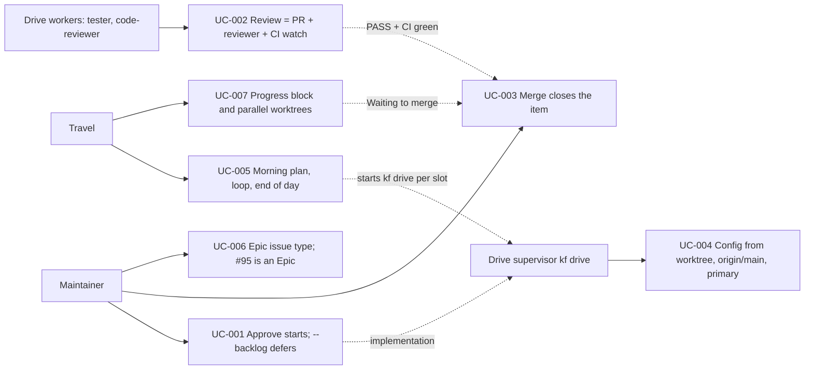

# Use Case Diagram

- Actors: Maintainer (decides: spec, plan, daily plan, destructive; does: merge), Travel (day orchestrator, no product code), Drive supervisor (`kf drive`), Drive workers (coder, tester, code-reviewer in item worktrees)
- Use cases: UC-001 approve starts or defers; UC-002 review opens the PR, runs the independent reviewer and watches CI; UC-003 merge on GitHub closes the item to `done`; UC-004 drive config resolution; UC-005 travel day; UC-006 Epic issue type; UC-007 progress block and parallel worktrees
- Relationships: UC-001 feeds the drive (implementation); UC-005 dispatches drives per slot and reads their stops; UC-002 PASS with green CI feeds UC-003 through the Waiting to merge bucket of UC-007; UC-004 is a precondition every drive relies on when the primary checkout is stale
