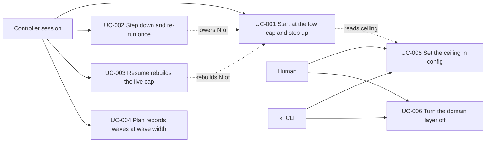

# Use Case Diagram

- Actors: Controller session, Human, kf CLI
- Use cases: UC-001..UC-006
- Relationships: UC-001 reads the ceiling of UC-005; UC-002 lowers and UC-003 rebuilds the N that UC-001 raises.
