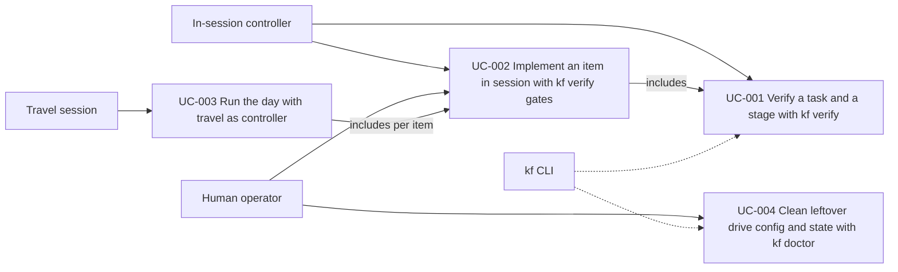

# Use Case Diagram

- Actors: Human operator, In-session controller, Travel session, kf CLI
- Use cases: UC-001, UC-002, UC-003, UC-004
- Relationships: UC-002 includes UC-001 after each task and before testing; UC-003 runs UC-002 for each item it holds; the kf CLI executes UC-001 and UC-004
