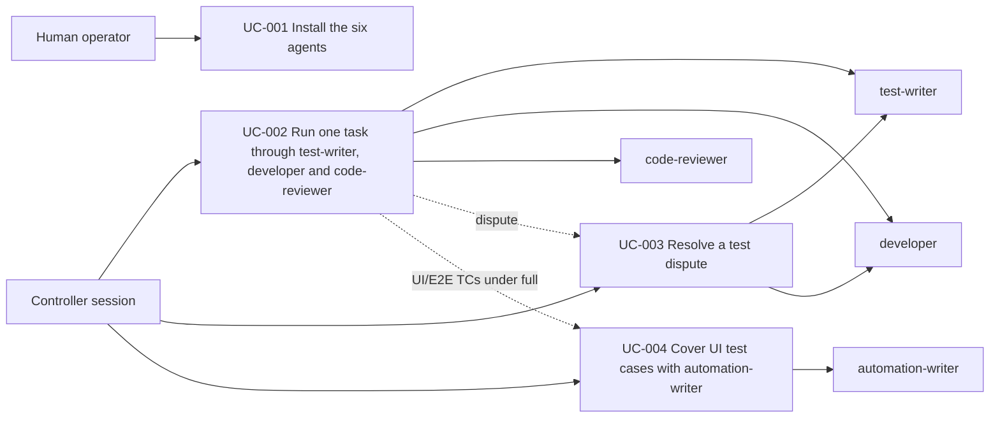

# Use Case Diagram

- Actors: Human operator, Controller session, test-writer, developer, automation-writer (code-reviewer is the existing seat)
- Use cases: UC-001, UC-002, UC-003, UC-004
- Relationships: UC-002 extends to UC-003 when the developer reports `TEST_DISPUTE`, and to UC-004 when a task carries UI/E2E TCs under `Level: full`
