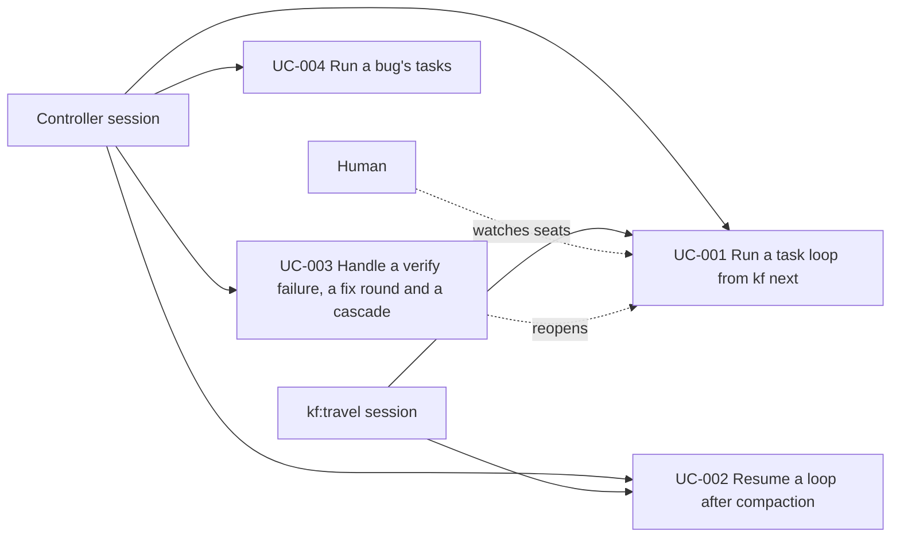

# Use Case Diagram

- Actors: Controller session, `kf:travel` session, Human
- Use cases: UC-001, UC-002, UC-003, UC-004
- Relationships: the `kf:travel` session runs UC-001 and UC-002 for items it owns; UC-003 returns to the loop of UC-001; the human only watches and gains no gate.
