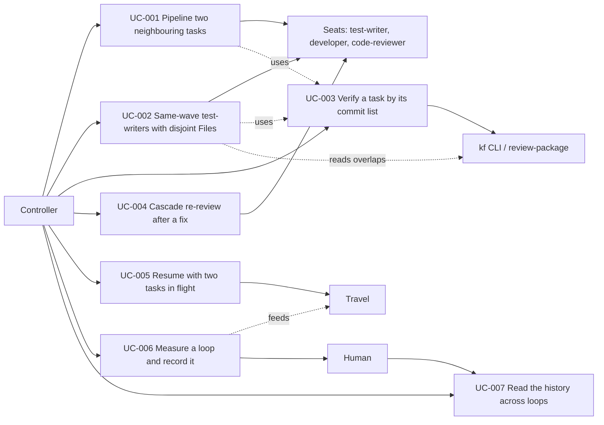

# Use Case Diagram

- Actors: Controller, Seats, kf CLI / review-package, Travel, Human
- Use cases: UC-001 – UC-007
- Relationships: pipelining and same-wave parallelism both verify and package each task by its commit list (UC-003); same-wave gating reads `kf tasks --json` `overlaps`; resume and the timestamped ledger are read by travel; `kf loop-stats` measures each loop (UC-006), feeds travel's measured work and appends the history the human reads (UC-007).
