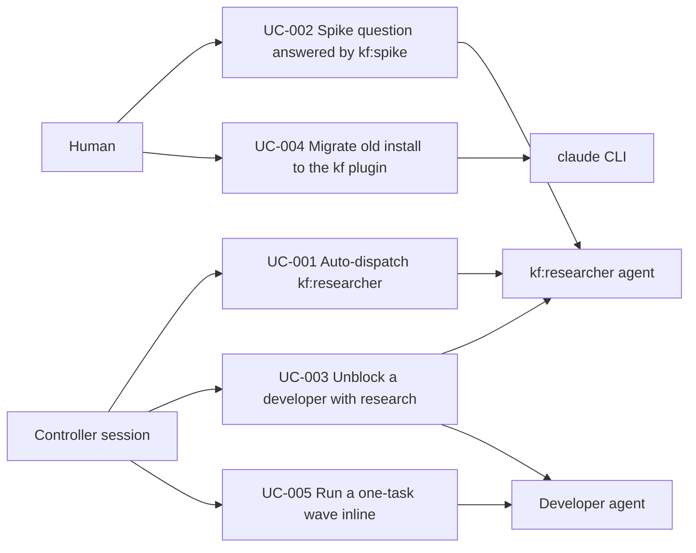

# Use Case Diagram

- Actors: Human, Controller session, kf:researcher agent, Developer agent, claude CLI
- Use cases: UC-001, UC-002, UC-003, UC-004, UC-005
- Relationships: the brainstorm/plan skills (UC-001), the spike skill (UC-002) and the implement skill (UC-003) dispatch the researcher; `kf install`/`doctor`/`uninstall` (UC-004) drive the `claude plugin` CLI and the shared `kf-*` copies.
