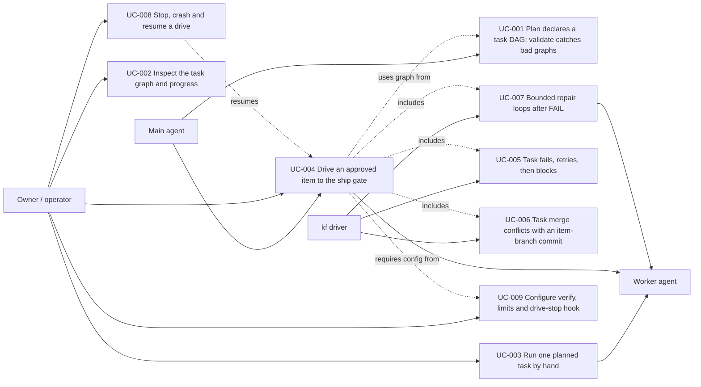

# Use Case Diagram

- Actors: Main agent (plans, hands off), Owner / operator (approves, starts, configures, inspects, stops), kf driver (detached supervisor), Worker agent (headless runner executing one task or one stage role)
- Use cases: UC-001 … UC-009
- Relationships: UC-004 includes task failure (UC-005), merge conflict (UC-006) and repair loops (UC-007); it depends on the validated graph (UC-001) and the harness configuration (UC-009); UC-008 resumes UC-004; UC-003, UC-004 and UC-007 dispatch work to the Worker agent.
