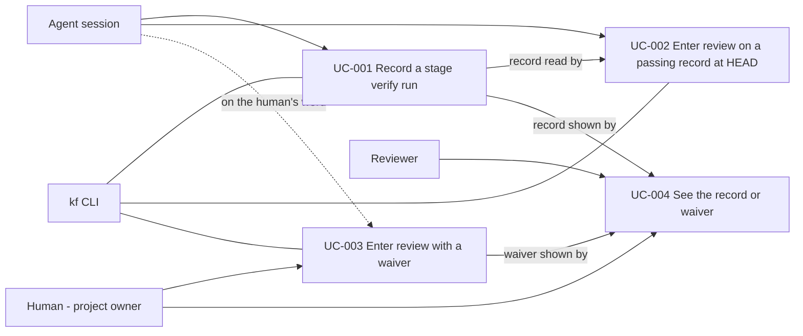

# Use Case Diagram

- Actors: Agent session, Human (project owner), Reviewer, kf CLI
- Use cases: UC-001, UC-002, UC-003, UC-004
- Relationships: UC-002 consumes the record UC-001 writes; UC-003 is the only path into review when no stage verify is pinned; UC-004 displays what UC-001 and UC-003 produced.
