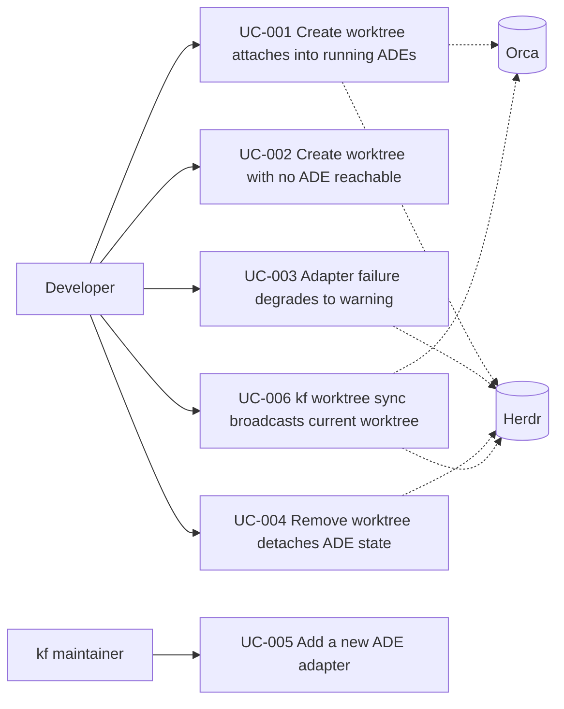

# Use Case Diagram

- Actors: Developer (runs kf), kf maintainer (extends the registry); Orca and Herdr are supporting systems.
- Use cases: UC-001 attach on create; UC-002 silent no-op without ADEs; UC-003 failure → warning; UC-004 detach on remove; UC-005 registry extension; UC-006 manual broadcast incl. foreign worktrees.
- Relationships: UC-001 and UC-006 exercise both ADEs through the same attach path; UC-003/UC-004 share the Herdr workspace lifecycle; UC-005 underpins all of them through the shared adapter interface.
