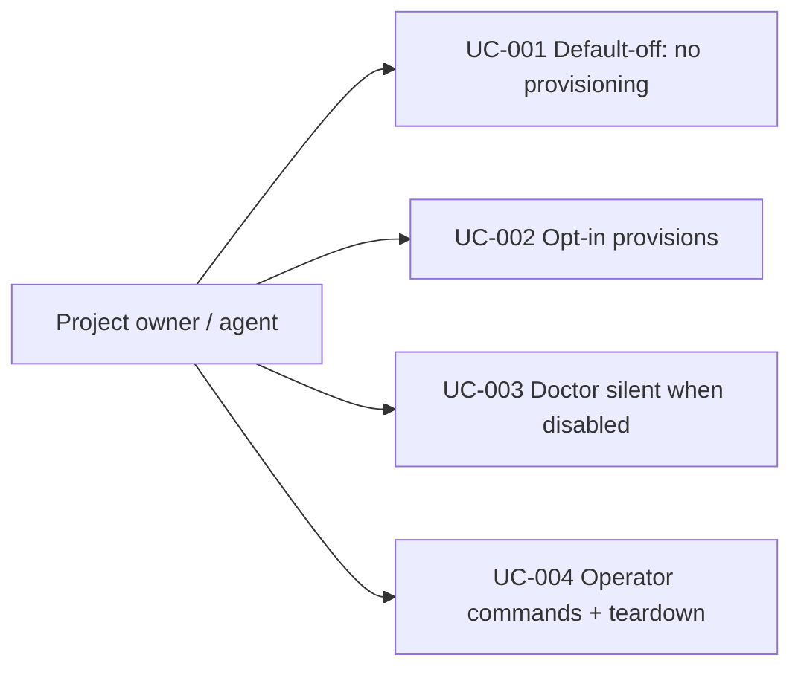

# Use Case Diagram

- Actors: Project owner, agent (CLI operator)
- Use cases: UC-001 default resolution skips provisioning; UC-002 explicit opt-in reproduces legacy behaviour; UC-003 doctor gating; UC-004 operator commands and teardown ignore the flag
- Relationships: all four are operator-initiated flows against `worktreeConfig`/doctor/teardown paths
