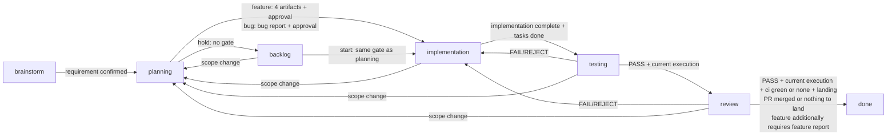

# Gates and the artifact contract

A gate is checked on the way out of the current state. `kf validate` runs most of the same checks so you see the failures early; `kf stage` and `kf archive` refuse the transition when a gate does not hold.

One group is not shared: the *direction* gate, which decides where a PASS or FAIL report may send an item. `validateFeature` does not call it, so `tasks_incomplete` and `testing_already_pass` never appear in `kf validate` and first surface when `kf stage` refuses the move. A clean `kf validate` is therefore not a promise that the next transition will be allowed.

## Required artifacts

| Phase | File | Minimum contents | Unlocks |
| --- | --- | --- | --- |
| 1 — Brainstorm / bug triage | `phase-1-spec-requirement.md`, a bug using the bug-report template | Feature: the requirement plus FR-XXX and an `## Affected surfaces` declaration (or `N/A`). Bug: reproduction, actual against expected, severity, regression strategy | Planning |
| 2 — Planning (feature) | `phase-2-implementation-plan.md` | Scope, tasks, impact, definition of done, risks | The execution contract |
| 2 — Planning (feature) | `phase-2-use-case-specification.md` plus `use-cases/UC-###(-<slug>).md` | Index and coverage in the phase file; each UC carries its own preconditions, flows and alternate or error flows | Design and testing |
| 2 — Planning (feature) | `phase-2-use-case-diagram.md` | A valid actor and use case diagram | Traceability |
| 2 — Planning (feature) | `phase-2-test-case.md` | TC-XXX entries linked to FR-XXX and UC-XXX | The testing contract |
| 4 — Testing | `phase-4-testing-result.md` | The current execution id, a PASS/FAIL/REJECT/BLOCKED verdict, the evidence | Review, or the repair loop |
| 5 — Review | `phase-5-review-report.md` | The current execution id, a PASS/FAIL/REJECT/REQUIREMENT_BUG verdict, the findings; on PASS also `ci: green\|none` and `landing: pr\|none` (with `landing: pr`, a recorded PR) | Closing the item, or the repair loop |
| 6 — Artifact (feature) | `phase-6-feature-report.md` | The summary, what changed, the tests, the docs, the known limits | A finished feature |

Implementation has no required artifact of its own in the schema, but the implement skill must finish the tasks in the plan and leave the code in a state that can be tested.

## Docs on entering `done`

Closing the item (`kf archive`, or the automatic close on a merged PR) copies nothing under `docs/`, for a feature or a bug: the work item folder moves into `.works/done/` and keeps every artifact for audit. The current docs are the living docs under `docs/specs/<context>/`, edited at review before the reviewers (see [artifacts](artifacts.md)); the legacy `docs/requirement`, `docs/use-cases` and `docs/testplan` snapshots an earlier release copied stay until `/kf:docs` consolidates them. An item approved before living docs whose PASS report records no `docs:` closes with the warning `⚠ <feature>: no living doc recorded (approved before living docs)`. `kf archive --skip-specs` was removed and exits 1 (`--skip-specs was removed: living docs are edited at review (docs/specs/); see kf instruct living-doc`).

The living-docs rules bind items approved from the living-docs release on (`kf approve` records `approval.livingDocs`); earlier items skip them. In planning the plan needs a `## Documentation Impact` that names a `docs/specs/<context>/<capability>.md` or waives with `none — <reason>` (`docs_impact_missing`), with `README` reserved for the index (`docs_capability_reserved`) and only declared contexts (`docs_context_undeclared`). A PASS review report needs `docs: updated` or `docs: none` (`docs_key_missing`) and a `docs_reason` for `none` (`docs_reason_missing`), and every `consolidates:` legacy feature fully removed (`docs_consolidation_incomplete`) — the review → done gate checks these too. In review `kf validate` also reads git at the item checkout against the merge-base with `origin/HEAD`: `docs: updated` with no committed change under `docs/specs/` (`docs_updated_no_change`), a capability file a bug adds (`docs_bug_new_spec`), a legacy feature removed only in part (`docs_legacy_half_removed`) or never named in a `## History` or `## Retired` section (`docs_legacy_unnamed`), and the structure of each touched context (`docs_heading_missing`, `docs_index_missing_entry`, `docs_index_dangling`). A failed git lookup is `docs_git_failed`, never a pass; a base that cannot be resolved fails `docs: updated` and is only a `docs_base_unresolved` WARNING for `docs: none`.

## What each direction requires



A PASS report names the commit it judged in `commit:`. While an item with a worktree is in review, a branch that moved past it raises the warning `review_stale`. The close never refuses for this, since the merge already happened, but it prints which commit was reviewed and which was merged.

The review → done direction gate adds the delivery checks on a PASS report: `review_ci_missing` (no `ci: green` or `ci: none`), `review_ci_red` (`ci: red` cannot pass; write FAIL and return to implementation), `review_landing_missing` (no `landing: pr` or `landing: none`) and `review_pr_missing` (`landing: pr` without a recorded PR). Merging on GitHub then closes the item; see [Review and closing](lifecycle.md#review-and-closing) for the close order and the branch-deletion safety.

`implementation → testing` is also blocked while `tasks.md` still holds an unfinished checkbox, which is the definition of done. `tasks.md` is not a required artifact: with no such file, this gate does not apply. The task loop ticks a task only after its commit passes `kf verify --task`.

## Contract and traceability

Feature planning builds a chain you can follow:

`FR-XXX` → `UC-XXX` → `TC-XXX` → implementation → testing evidence → review finding.

A use-case file is named `UC-###-<slug>.md` — `UC-001-create-task.md` — so a directory listing reads like a table of contents. The older plain `UC-###.md` stays valid; every check keys on the `UC-###` prefix, which must match the id declared inside the file.

IDs must match exactly; `FR-001` is never treated as `FR-0010`. A TC missing its FR or UC reference, a reference that does not exist, a duplicate TC id, an empty file or an unreplaced placeholder all fail validation. The agent still has to review the content of each section and the totals in each table.

The validator also scans artifact content for real secrets, such as a Bearer token, an API key, a private key or a password written as `KEY=value`, and fails with `artifact_secret` when it finds one. An artifact must never carry a credential. Placeholder values like `{key}`, `<token>`, `changeme`, `redacted` or a run of four or more `x` are not flagged. The exemption applies to the **captured value**, not to the whole line: `TOKEN=ghp_… # example` is still flagged. High-confidence formats (`ghp_`/`github_pat_`, `sk-`, `AKIA`, `xox*-`, a PRIVATE KEY header, a three-segment JWT starting `eyJ`, and Slack or Discord webhook URLs) are exempt only when the value itself is masked with `xxxx` or `****`. Each of those begins with something no honest template would invent, so no wording on the line excuses them.

A connection string carrying a password (`scheme://user:<password>@host`) is also flagged, with the password as the captured value — but it is **not** high-confidence, because it has no such marker: it is pure URL shape, which a template like `scheme://user:<password>@host` has too. It uses the ordinary placeholder exemption, so a real password is caught and an obvious placeholder is not. A URL with no password is never flagged; there is nothing to leak. The error message never echoes the secret.

The secret scan is the one check that ignores the stage entirely. It runs on **every artifact that exists on disk**, whether or not the workflow has reached the phase that asks for that file, and including items in `cancelled` — which sit at `STAGE_INDEX = -1` and are exempt from every other artifact check. A credential is a credential regardless of where the item stands, and cancelling an item must not be a way to take a committed token off the radar.

The move from testing to review also needs evidence kf produced itself. `kf verify <feature> --stage` appends a record of every run that ran a command to `<item>/loop/stage-verify.jsonl`: the item's HEAD sha, whether the tracked tree was clean, each pinned command with its outcome (exit code, signal, not started, not run), a sha256 of the output and the overall exit. `kf stage <feature> review` reads the latest record — a wave verify's record (`kf verify <feature> --wave <w>`, tagged `wave`) counts like any other — and runs nothing: it refuses with `verify_record_missing` (no record), `verify_record_invalid` (the last line cannot be read — an earlier pass never stands in), `verify_record_failed`, `verify_record_stale` (the record names another commit than HEAD), `verify_tree_dirty` (tracked changes at record time or now), `verify_config_changed` (`harness.verify.stage` differs from the record, order included) or `verify_dir_missing`. A project with no `harness.verify.stage` is refused with `verify_not_configured` until the item carries a waiver: `kf verify <feature> --stage --waive "<reason>"` stores the reason, the time and who gave it, is refused while stage commands are pinned, and is shown by `kf status` and in the review report's `verify` row. Every code passes with `--force`, recorded as a bypass. The testing report's `## Commands and Evidence` table describes the run; `testing_exit_code` no longer exists.

The Phase 2 approval is a SHA-256 fingerprint of the requirement, the four planning artifacts and every use-case file for a feature; a bug's fingerprint covers the bug report alone. Editing the contract after approval forces a return to planning, a rewrite and a fresh approval. That includes the plan's Task Breakdown — dependencies and `Files` — so the allowlist `kf verify --task` enforces is the one that was approved.

## Cancelled

`cancelled` is the one stage with **no artifact gate**. Its `STAGE_INDEX` is `-1`, so every "is this artifact due yet" and "are we past planning" comparison comes out false, and the validator skips artifacts, approval, traceability and report semantics entirely. In exchange it has exactly one requirement of its own: `cancellation.reason` must not be empty, and a missing one is `cancellation_missing`.

`kf cancel` runs the `cancelled.sh` hook like any other transition and never touches `docs/`; `--purge-docs` was removed and is refused with exit 1. A cancelled item cannot be archived.

An item cancelled *out of* `done` reopens into `done`: `kf stage` restores its `archived` status and writes no docs.

On the numbers: cancelled items are taken out of the denominator of `completionRate`, so dropping something does not dent the rate.

## Force and recovery

`--force` is a deliberate escape hatch for skipping validation or a directional gate. It does not belong in the normal flow, and when it is used the reason must be written into the review or the feature report.

Every time `--force` skips a gate that was actually failing, or `--skip-hooks` skips a hook that actually exists, `kf stage` and `kf archive` write a record into `.kfw.json`:

```json
"bypasses": [
  { "at": "20260919_1230", "from": "brainstorm", "to": "planning", "flag": "force", "codes": ["requirement_unconfirmed"] },
  { "at": "20260919_1231", "from": "planning", "to": "backlog", "flag": "skip-hooks", "codes": ["hook:/path/.kf/hooks/backlog.sh"] }
]
```

A flag that skips nothing, because the gate passed or no hook exists, records nothing. `kf validate` raises the `gate_bypassed` warning, `kf status` prints `Bypasses: N`, and `kf view --json` and the dashboard count the work items carrying one. There is no command to erase a record. The limit is worth stating plainly: this is a trail for a human reviewer, not a guarantee, because an agent can still edit the JSON by hand.

- A phase hook fails: the transition is refused. Fix the hook, or use `--skip-hooks` once you understand what that skips.
- Testing or review comes back `FAIL` or `REJECT`: return to implementation, fix the code, then enter testing again for a new execution id.
- `BLOCKED`: stop and report the blocker. Never fake a PASS.
- `REQUIREMENT_BUG`: stop the feature and tell the user. Continue only on a clear decision from them about the scope or the requirement.
- Archive fails midway: the CLI returns the feature to review and restores the metadata and specs where it can. When the rollback is incomplete, the error says so plainly so it can be sorted out by hand.
