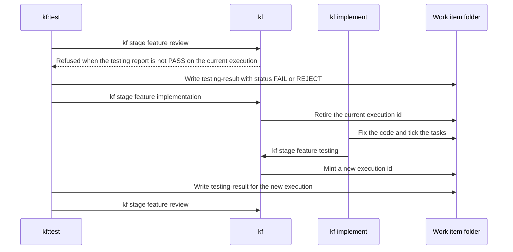

# Workflow Lifecycle

## The whole flow

```mermaid
flowchart TD
    A([User describes a feature or a bug]) --> B{Does the project have .works?}
    B -- No --> C[kf init]
    B -- Yes --> D[Read the repo and pick the current phase]
    C --> D
    D --> E{Is the work item a bug?}
    E -- No --> F[Brainstorm: pin down scope and acceptance]
    E -- Yes --> G[Bug triage: reproduce, actual vs expected, severity]
    F --> H[kf new + phase-1-spec-requirement.md]
    G --> H
    H --> I{Requirement confirmed?}
    I -- Not yet --> E
    I -- Yes --> J[kf stage item planning]
    J --> K{Work item kind?}
    K -- Feature --> KP[Planning: implementation plan + one file per UC + diagram + test plan]
    K -- Bug --> KB[Planning: triage report + fix scope + regression strategy]
    KP --> L{Human approves the execution contract?}
    KB --> L
    L -- Not yet --> K
    L -- Yes --> M[kf approve: store the contract fingerprint and start]
    M --> O[Implementation in the item worktree: the pipelined task loop - test-writer, developer, code-reviewer per task, ledger]
    L -- "Approved, but later: kf approve --backlog" --> P[Backlog: hold the approved contract]
    P --> Q[Start it: kf stage item implementation]
    Q --> O
    O --> R{Build green and tasks done?}
    R -- Not yet --> O
    R -- Yes --> S[kf stage item testing]
    S --> T[Mint a new execution id]
    T --> U[Run the tests from the Test Strategy]
    U --> V[Write testing-result carrying the execution id]
    V --> W{Testing PASS?}
    W -- FAIL/REJECT --> O
    W -- BLOCKED --> X([Stop and report the blocker])
    W -- PASS --> Y[kf stage item review]
    Y --> Z[Facts and review pack: lint, build, suite counts, rules project then user then package]
    Z --> Z2[Independent code-reviewer agents, tier from the diff; evidence verified]
    Z2 --> AA[Write review-report carrying the execution id]
    AA --> AB{Review result?}
    AB -- FAIL/REJECT --> O
    AB -- REQUIREMENT_BUG --> AC([Stop and ask the user to decide])
    AB -- PASS --> PR[Push the item branch, open the PR, watch CI, record ci and landing in the report]
    PR -- CI red --> O
    PR -- "CI green or none" --> MG{PR merged on GitHub, or landing none with nothing ahead of the default branch?}
    MG -- Not yet --> MG
    MG -- "Yes: next kf status --change / kf sync / kf archive" --> AD{Work item kind?}
    AD -- Feature --> FC[Write feature-report]
    FC --> AE[kf archive: copy requirement, use-case and testplan docs]
    AD -- Bug --> BC[Update the related feature docs if needed]
    BC --> BA[kf archive: keep the bug record with its test and review]
    BA --> AF
    AE --> AF([done: item closed])
```



There is a second way out of this flow: `kf cancel <feature> --reason "<why>"` stops a work item for good at any stage, `done` included when something supersedes it. The reason is mandatory and is stored in `.kfw.json` together with the stage it stopped in, so reopening it is `kf stage <feature> <that stage>`. This is the user's decision; the agent only suggests it on a `REQUIREMENT_BUG` or a dead scope.

Phase 1 and the Phase 2 approval are the two points where the user decides; `kf approve` is both the approval and the start (`kf approve --backlog` approves and defers). There is no ship-or-archive decision after a PASS review: the item is closed by the merge on GitHub. A feature produces all four planning artifacts; a bug uses its bug report as the triage contract and produces no feature use cases or test plan. If behaviour appears beyond the scope of the fix, tell the user and let them decide before opening a separate feature. Once the item has started the agent runs on its own inside the execution contract. Two exceptions still need the user: `REQUIREMENT_BUG`, and any change of scope.

## Two layers

The flow above is the **item** layer: one work item, from brainstorm to `done`. Above it sits the **day** layer: travel (the day orchestrator) decides which items to start, keeps several of them moving in its own session, and reports what needs the human and what waits to merge. It runs the phase skills itself, one slot per item — it never approves, merges or archives an item. `kf status --all` ends with the same buckets computed from kf state: `Needs you`, `Waiting to merge` (the PR URL and `gh pr merge <n>`, plus any docs branch awaiting push or not proven merged, with its `git push -u origin <branch>`). `Needs you` also lists a review PASS item whose close was refused, as `review PASS but not closed: <refusal heading> <failed check codes>`.

"Runs on its own" is the in-session loop: the session dispatches the test-writer, developer and code-reviewer per task, runs `kf verify --task` (`--base`, or `--commits` for the pipelined loop, where developers share the worktree under the live developer cap (starts at min(2, ceiling), ceiling `harness.developers.max`) on tasks whose Files overlap no open task, each committing through `commit-task.mjs`, tasks may complete out of order, and the next task's test-writer runs beside them) after each task commit and `kf verify --stage` before testing, and carries the item through testing and review to an open PR and a review report with `ci` and `landing`, or stops earlier with a named blocker the human must act on. See [the harness guide](harness.md).

## Review and closing

Review runs in a fixed order. An independent `code-reviewer` reads the branch diff first; FAIL or REJECT returns to implementation before any PR exists. Only after a reviewer PASS is the item branch pushed and a PR opened (when none is recorded). If the repository has CI on the PR, its checks are watched until green or red; red returns the item to implementation, and the fix is re-tested and re-reviewed on the same PR. The review report records `ci: green|red|none` and `landing: pr|none`.

The report is gated at review → done: a PASS needs `ci` green or none (`review_ci_missing`, `review_ci_red`), a `landing` value (`review_landing_missing`), and with `landing: pr` a recorded PR (`review_pr_missing`).

Nobody is asked "archive?". An item with a PASS review closes on the next `kf status --change <feature>` (or `--all`), `kf sync` or `kf archive` once its PR is merged on GitHub, or, for `landing: none`, once it has 0 commits ahead of origin's default branch. Until then `kf status` says to merge the PR (its URL) and run `kf status --change <feature>` again. A PR that was closed unmerged is refused.

The close runs in a binding order: gates, refusal while a close is in progress, refusal while the worktree is dirty, the `done` hook, worktree teardown, branch deletion (local, then origin), canonical docs, the move into `.works/done/`, and the metadata stamp.

Branch deletion is conservative. The PR head must be the item branch. The local branch is deleted only when its tip equals the PR head, and the origin branch is deleted with a lease. A branch with commits past the merged head is kept and reported.

Canonical docs are written into the working tree only when the primary checkout is on a clean, current default branch. Otherwise they go to an unpushed `docs/<context>-<feature>` branch, recorded as `meta.docsBranch`; `kf doctor` warns while it is unpushed (`docs_branch_unpushed`).

An older project is migrated once, by `kf status` or `kf sync`: `.works/dones/*` moves to `.works/done/`, and `.works/shipping/*` returns to `review` (a merged PR closes it like any other). `kf stage <item> shipping` and `kf stage <item> dones` are refused with a hint, and `kf ship` is a deprecated alias that exits 1 — review opens the PR and the merge on GitHub closes the item. Publishing to npm is a manual `gh release create v<version>`, which triggers the release workflow.

## Starting a feature, step by step

```mermaid
sequenceDiagram
    actor User
    participant Orchestrator as kanban-flow
    participant CLI as kf
    participant FS as .works/.kf/docs

    User->>Orchestrator: Describes the context and the feature
    Orchestrator->>CLI: kf init when .works is missing
    Orchestrator->>CLI: kf new item --context context [--type bug]
    CLI->>FS: Create the brainstorm folder, the metadata and the spec or bug template
    Orchestrator->>User: Summarise the requirement or the triage, plus the open questions
    User-->>Orchestrator: Confirms, or adjusts the scope
    Orchestrator->>FS: Write status: confirmed into the requirement or bug report
    Orchestrator->>CLI: kf stage feature planning
    Orchestrator->>User: Summarise the execution contract
    User-->>Orchestrator: approve
    Orchestrator->>CLI: kf approve item (--backlog to defer)
    CLI->>FS: Store the approval contractHash, stage to implementation (or backlog)
    CLI->>FS: Provision the git worktree + <feature>.<baseDomain> route (only when worktree.enabled; fails closed when it cannot)
```

## Fixing a failure, step by step



An old report is kept as evidence, but it can never stand in as the result of a new execution.
