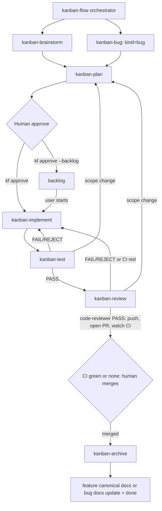

# Skill routing

`kanban-flow` is the orchestrator. Each phase skill owns only that phase's work; the real state stays with the CLI and the filesystem.

The orchestrator also owns the harness: when `.kf/config.json` assigns roles to a stage, `kf run` hands that stage to worker sessions instead of the orchestrator doing the work itself. The routing below still decides *which skill* loads; the harness decides *who runs it*. See [the harness guide](harness.md).

Inside a phase, the skills hand bounded jobs to three **agents** with a fresh context — `scout` (what depends on the thing about to change), `spec-reviewer` (the contract before the human confirms or approves), `code-reviewer` (every task's diff, and the whole branch at review). `kf install` puts their definitions in `.claude/agents/` for Claude Code; other runtimes paste the agent file into a plain subagent. A phase skill that dispatches one leaves a named line (`Agent(code-reviewer)`) in the transcript; a missing line is a skipped step. See [in-session agents](harness.md#in-session-agents).

Above the item sits one more skill, `travel`, the day orchestrator. It does not appear in the diagram because it is not a phase: it plans a day across items, starts `kf drive` for started ones and reports what needs the human. It never approves, archives, stages or merges.

## Responsibilities

| Skill | What it owns | Gate to advance | What it must not decide alone |
| --- | --- | --- | --- |
| `kanban-flow` | Classify the request out loud (spike: no work item, an answer; bounded: every gate at the smallest honest size; architectural: the full process), read the state, route to the phase, name the gate, resume at the right point, and leave a named line for every delegated step (`Skill(...)`, `Agent(...)`) so a skipped step is visible | — routes only, no stage of its own | Never treat a requirement as confirmed on its own, never bypass a human gate, never downgrade a path to skip a gate |
| `kanban-brainstorm` | Ground the names the idea uses, run a divergence framework on the architectural path (skipped on the bounded one), pin down the problem, the goal, the scope and the acceptance criteria, dispatch `spec-reviewer` once, write Phase 1 | Requirement `status: confirmed` | Never move to planning before the user has confirmed |
| `kanban-plan` | For a feature, produce the execution plan, each UC file, the diagram, the test plan and the traceability; for a simple bug, keep the triage contract and write a full plan only when the behaviour contract changes. The orchestrator grounds every name the spec commits to, dispatches a `scout` agent per thing that changes for the impact survey, writes the skeleton (with `## Global Constraints` and `## Review Focus`), has one subagent per UC file once the IDs are fixed, writes the diagram and test cases, and dispatches a `spec-reviewer` with a fresh context before asking for approval | Feature: all four phase-2 artifacts plus one file per UC, then the human `kf approve`, which starts the item (`kf approve --backlog` parks it instead). Bug: the confirmed triage report, then approval | Never approve the contract; the skill only relays the human's approve or `--backlog` reply and does not ask start-versus-backlog itself |
| `kanban-bug` | Triage the bug: reproduce it, record actual against expected, severity, root cause and the regression requirement | Bug report `status: confirmed` — the same gate as brainstorm | Never settle on a root cause alone, never start implementation alone |
| `kanban-implement` | Execute the tasks in the contract, hold the scope, update code and tests. When a task harness is configured (`harness.verify.stage` and worktrees on), hand the item to `kf drive` and act on its stop codes; when the harness only assigns implementation to roles, hand it off with `kf run --detach`; otherwise run the subagent-driven task loop — a fresh implementer per task from a brief file, a `code-reviewer` on that task's diff, a fix loop of at most five rounds (the implementer resumed for three, a fresh one a tier up for two), LOW findings deferred to the review stage, every ruling in `<item>/loop/progress.md`. A `usage_limit` stop is not a failure: relay the reset text the stop quotes and let the human run `kf drive <feature>` again later, which resumes the same worker session with its uncommitted work. An item whose travel ledger line is `driving` or `blocked` belongs to `travel`: never start a second drive on it. As a task worker (`kf-run:<id> TASK-###`) it implements exactly one task inside its file allowlist and never dispatches | No artifact of its own; every `tasks.md` checkbox ticked, the ledger's `complete` line per task | Never widen the scope or skip the plan without returning to planning; never fix a reviewer's finding in the controller session |
| `kanban-test` | Run the tests, record the execution id and the evidence, classify as PASS, FAIL, REJECT or BLOCKED | `phase-4-testing-result.md` carrying `status: PASS` on the current execution id | Never turn a BLOCKED into a PASS |
| `kanban-review` | Establish the facts mechanically (lint, build, the suite's real counts, the anti-pattern scan, the rule files), pick the tier from the diff (`select-tier`: one `code-reviewer` under 200 code lines, plus a `contracts` reviewer when a shared surface changed; five dimensions in parallel at 201–600; `opus` above 600 or on a critical area), write the review pack, dispatch independent `code-reviewer` agents, refute findings whose evidence quote is not in the file, and write the report from what survived — including the AI-risk lens: phantom tests, catch-and-swallow, scope drift. Only after the reviewers pass: push the item branch, open the PR when none is recorded, and watch the PR's checks until they are green or red (`references/ci-watch.md`); a repository without CI records `ci: none`. A PR is opened for reviewed code only | `phase-5-review-report.md` carrying `status: PASS` on the same execution id, its `## Reviewer` section naming tier, agents, models and the verification counts, plus `ci: green` or `none` and a `landing:` value (`pr` with a recorded PR, or `none`). A FAIL or REJECT verdict, or red CI, returns the item to implementation before it is tested and reviewed again | Never write a finding of its own beyond the mechanical facts; never open a PR before the reviewer PASS; never merge, re-run, cancel or approve a workflow. The next step after PASS is the human merging the PR on GitHub |
| `kanban-archive` | The closing step, run internally once the change has landed — a review PASS item closes on the next `kf status`, `kf sync` or `kf archive` after its PR is merged, or at once when `landing: none` and nothing is ahead of the default branch. For a feature, reconcile earlier docs the feature supersedes (banner + `docs/workflow/*` update, recorded under `## Docs Reconciled`), write the feature report and then call `kf archive`, which is what copies the canonical docs; for a bug, settle the docs impact and update only the related docs when needed | `kf archive`: current PASS reports plus, for a feature, `phase-6-feature-report.md` — then the `done` hook, the worktree and branch cleanup, and the canonical sync | Never copy the canonical docs by hand — a hand copy lands before the archive gates (merge check, PASS reports) have run, so the docs claim delivery the system has not confirmed. Mark superseded docs with a banner; never rewrite another feature's snapshot body. Never ask the human whether to archive, and never delete data, deploy or publish on its own |
| `travel` | The day orchestrator above the items. On a new day it reads yesterday's ledger and `kf status --all`, sizes every line S, M, L or XL, prints the plan with its batch budget and calibration, and waits for the human to approve or edit it. Then it keeps up to `slots=N` (default 3) `kf drive <feature>` runs busy, polls `--status` rather than `--watch`, collects the stops, refills, and prints a progress block (`running: A/SLOTS`, **Needs you**, **Waiting to merge**, the running items and their worktrees). A crash gets one retry, then the line is `blocked` with a reason and the next command. At the end of the day it prints done, blocked, waiting-to-merge and carry-over lines and rewrites the unfinished ones as `carry-over`. State lives in `.kf/travel/` (see [artifacts](artifacts.md#the-day-files-under-kftravel)) | The human's approval of the day's plan; the ledger line `done` appends an estimate row | Never `kf approve`, `kf archive`, `kf stage` or merge; never dispatch an XL line until it is split or the human overrides; never dispatch two items the plan marked `sequential` together; an item whose line is `driving` or `blocked` is its own until the human says the fix is done |

The directional gates — which report status allows which move — are detailed in [gates](gates.md#what-each-direction-requires).

## Resuming and handing off

When starting or resuming a feature:

1. Read `kf status --change <feature> --json` and `kf validate --change <feature> --json`.
2. Read the artifacts of the current state and the one before it. Do not guess from the folder name.
3. In `planning` with a stale approval, finish the contract again and ask for a fresh `kf approve`.
4. In `testing` or `review`, use the `executionId` the metadata holds. A report from another execution is not valid.
5. On a `FAIL` or a `REJECT`, fix it in implementation and return to testing. On a `REQUIREMENT_BUG`, stop and tell the user. On a `BLOCKED`, stop and report the blocker.
6. Archive only after a PASS review and a landed change (the merged PR). A feature needs its full feature report; a bug needs a settled docs impact.

The phase 6 artifact is the handover document. It states what actually changed, which tests ran, which docs were updated, what limits remain and which follow-ups were accepted.
