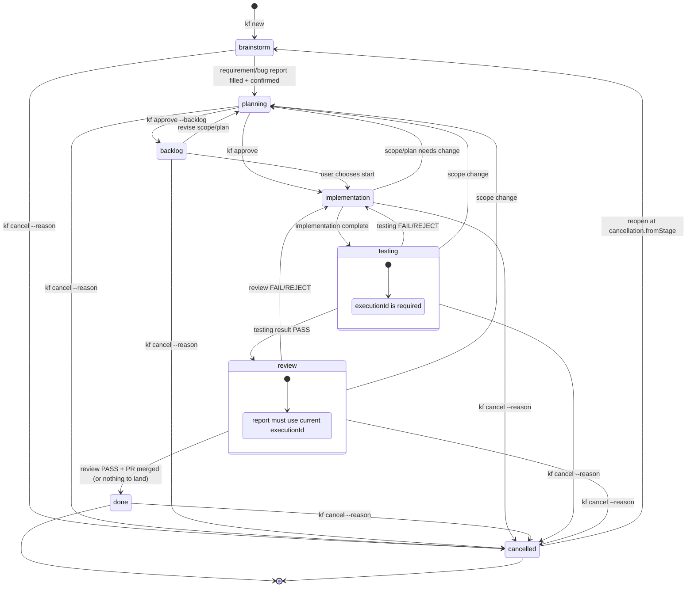

# State machine



## States and transitions

| State | What it means | Allowed transitions |
| --- | --- | --- |
| `brainstorm` | Working the requirement out with the user | `planning` |
| `planning` | A feature settles its execution contract, a bug confirms its triage contract; then approval, which starts the item (`kf approve`) or defers it (`kf approve --backlog`) | `backlog`, `implementation` |
| `backlog` | The contract is approved but work has not started | `implementation`, `planning` |
| `implementation` | The agent executes against the approved contract | `testing`, `planning` |
| `testing` | Run the tests from the test plan and record the outcome | `review`, `implementation`, `planning` |
| `review` | Review the code, the scope and the architecture, and write the report | `done`, `implementation`, `planning` |
| `done` | Closed and archived (folder `.works/done/`); a terminal state | `cancelled`, via `kf cancel` |
| `cancelled` | Stopped for good; it sits off the linear track, so no artifact is ever demanded of it | Back to `cancellation.fromStage` only |

The CLI allows only the edges above. Never move a `.works/` folder by hand.

## The guards that matter

- The requirement or bug report must be filled in and marked confirmed before it leaves `brainstorm`.
- Leaving `planning` needs all four planning artifacts and the UC files for a feature; a bug needs only a filled bug report and a real human's approval. The approval stores a fingerprint of the matching contract, so editing the contents afterwards makes it stale.
- Every entry into `testing` mints a new `executionId`. Both `phase-4-testing-result.md` and `phase-5-review-report.md` must carry the current one.
- `FAIL` and `REJECT` return to `implementation`. `BLOCKED` stops the flow. `REQUIREMENT_BUG` is a stop condition in review: never rewrite the requirement or move the state on your own.
- Only a `PASS` review whose testing and review match the current execution reaches `done`, and its report must carry `ci` green or none and a `landing` value (`review_ci_missing`, `review_ci_red`, `review_landing_missing`, `review_pr_missing`). A feature also needs `phase-6-feature-report.md`; a bug does not. On top of that, closing is the delivery gate: a recorded `pr` must be verifiably merged — an item that passed review but has not landed waits in `review` ("awaiting merge" in status/doctor) — and `delivered`/`deliveredAt` is stamped on `.kfw.json` when finalization completes.
- There is no `shipping` stage. Review opens the PR (after the independent `code-reviewer` passes) and watches CI; the merge happens on GitHub and kf never merges. Merging closes the item on the next `kf status --change <feature>` (or `--all`), `kf sync` or `kf archive`: gates, close-in-progress and dirty-worktree refusals, the `done` hook, worktree teardown, branch deletion, canonical docs, the move, the metadata stamp — in that order. The PR head must be the item branch; the local branch is deleted only when its tip equals the PR head, the origin branch is deleted with a lease, and a branch with commits past the merged head is kept and reported. `landing: none` closes when the branch has 0 commits ahead of origin's default branch. When the primary checkout is not on a clean, current default branch, the canonical docs go to an unpushed `docs/<context>-<feature>` branch (`meta.docsBranch`). A project from before this change is migrated once: `.works/dones/*` moves to `done`, `.works/shipping/*` returns to `review`. `kf stage <item> shipping|dones` is refused with a hint, and `kf ship` is a deprecated alias that exits 1.
- Entering `implementation` with `worktree.enabled` (opt-in, off by default) also provisions the item's git worktree on branch `<prefix>/<feature>` plus its `<feature>.<baseDomain>` route — the transition fails closed when that cannot happen, and code work happens there rather than on the main checkout. The prefix resolves `worktree.branchPrefix` → `worktree.gitconfigName` → `git config user.name` → `kf/`. Closing and `kf cancel` tear the worktree and route down but keep the branch, refuse while it is dirty, and warn when its commits are not merged into HEAD.
- The in-session loop moves an item only through the transitions above, with the same gates and hooks and never with `--force` or `--skip-hooks`. It stops once review has opened the PR: the merge, and with it `done`, stays a human decision on GitHub.
- The only way into `cancelled` is `kf cancel`, and `--reason` is mandatory. The only way out is back to the stage it stopped in (`cancellation.fromStage`), at which point `cancellation` and `status` are cleared from the metadata — except a reopen straight back into `done`, which restores `status: archived` and re-syncs the canonical docs through the archive path. `kf archive` refuses a cancelled item.

The minimum metadata looks like this:

```json
{
  "schema": "kanban-flow",
  "kind": "feature",
  "feature": "payment-retry",
  "context": "billing",
  "created": "20260917_1405",
  "approval": {
    "status": "approved",
    "by": "human",
    "at": "20260917_1430",
    "contractHash": "sha256:..."
  },
  "executionId": "uuid-of-the-current-testing-run"
}
```

The `executionId` is cleared on a return to planning **and on every entry into implementation**, then reissued when a new testing execution begins. The implementation reset is the one that matters in a FAIL loop: it is what stops the old testing evidence from counting for the repaired code. A bug report lives in `phase-1-spec-requirement.md` using the bug template; it needs none of the feature planning artifacts. If new behaviour appears beyond the scope of the fix, tell the user and let them decide before opening a separate feature.
